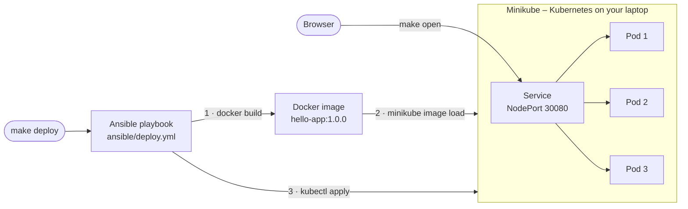

# Kubernetes on your laptop: Minikube + Docker + Ansible

A small proof of concept that runs completely on your own machine – no cloud account, no servers.

- **Docker** packages a tiny Python web app into an image
- **Minikube** runs a single-node Kubernetes cluster locally
- **Ansible** automates all of it: build → deploy → test, with one command

```bash
make deploy   # build the image, deploy 3 pods, smoke-test them
make open     # open the app in your browser
```

The page shows **which pod** answered your request. Refresh it and you see Kubernetes load-balancing across the replicas.

## How it works



`make deploy` runs the Ansible playbook [`ansible/deploy.yml`](ansible/deploy.yml), which

1. checks that Docker, Minikube and kubectl are installed,
2. starts Minikube if it isn't running yet,
3. builds the image with Docker and loads it into Minikube (no image registry needed),
4. fills the settings from [`ansible/group_vars/all.yml`](ansible/group_vars/all.yml) into the Kubernetes manifests in [`k8s/`](k8s) and applies them,
5. waits until all pods are ready, then sends 20 requests to the app from inside the cluster to prove it works.

Running it again is safe: Kubernetes objects that didn't change stay untouched, and pods are only replaced when the version changes.

## Prerequisites

Minikube needs at least 2 CPUs, 2 GB of free memory and 20 GB of free disk space. Install these tools:

| | How to install Docker, Minikube, kubectl, Ansible and make |
|---|---|
| **macOS** | Install [Docker Desktop](https://docs.docker.com/desktop/setup/install/mac-install/) and start it, then `brew install minikube kubectl ansible` |
| **Linux** | [Docker Engine](https://docs.docker.com/engine/install/) (then `sudo usermod -aG docker $USER` and log in again), [Minikube](https://minikube.sigs.k8s.io/docs/start/), [kubectl](https://kubernetes.io/docs/tasks/tools/install-kubectl-linux/), Ansible via `pipx install ansible-core` or your package manager, and `make` (`sudo apt install make`) |
| **Windows** | Ansible doesn't run on Windows directly. Install [WSL 2 with Ubuntu](https://learn.microsoft.com/windows/wsl/install) and Docker Desktop with WSL integration, then follow the Linux steps inside Ubuntu. Clone the repo inside Ubuntu (e.g. `~/`), not under `/mnt/c` |

Check that everything is there:

```bash
docker info > /dev/null && minikube version && kubectl version --client && ansible --version
```

## Quick start

```bash
git clone https://github.com/<your-user>/minikube-ansible-poc.git
cd minikube-ansible-poc
make deploy
make open
```

The first `make deploy` takes a few minutes because Minikube downloads Kubernetes. After that, a deploy takes well under a minute.

> **macOS / Windows:** `make open` keeps running, because it holds a tunnel into Minikube open. Leave the terminal open while you use the app and press `Ctrl+C` when you're done.

## Things to try

| Try this | What you'll see |
|---|---|
| Refresh the page a few times | Different pod names: the Service spreads the requests over all pods |
| `make deploy REPLICAS=5`, then `make status` | Kubernetes scales from 3 to 5 pods |
| `make deploy VERSION=1.1.0` | A rolling update: new pods start one by one, and old ones only stop once the new ones are ready – no downtime. Watch it in a second terminal with `kubectl -n demo get pods -w` |
| `kubectl -n demo delete pod -l app=hello-app` | Self-healing: Kubernetes immediately starts replacement pods |
| `make logs` | Which requests each pod handled |
| `minikube dashboard` | The Kubernetes web UI |

Changed the code in `app/main.py`? Deploy it as a new version, e.g. `make deploy VERSION=1.2.0` – Kubernetes only replaces the pods when the version changes.

## Commands

| Command | What it does |
|---|---|
| `make deploy` | Build the image and deploy it (starts Minikube if needed) |
| `make open` | Open the app in your browser |
| `make status` | Show the deployment, the pods and the service |
| `make logs` | Show the latest log lines of every pod |
| `make test` | Run the unit tests (needs `pip install pytest -r app/requirements.txt`) |
| `make destroy` | Remove the app – Minikube keeps running |
| `make stop` | Stop Minikube |

No `make`? Every target is a single command you can copy from the [`Makefile`](Makefile), e.g. `ansible-playbook ansible/deploy.yml -e app_version=1.1.0`.

## Project structure

```
.
├── app/                      the web app
│   ├── main.py               Flask app with /, /api/info and /health
│   ├── test_main.py          unit tests
│   ├── requirements.txt
│   └── Dockerfile
├── k8s/                      Kubernetes manifests (Ansible fills in the {{ variables }})
│   ├── namespace.yaml.j2
│   ├── deployment.yaml.j2    3 replicas, health checks, rolling updates
│   └── service.yaml.j2       one address that load-balances over the pods
├── ansible/
│   ├── deploy.yml            build → load → apply → smoke test
│   ├── destroy.yml           removes everything again
│   ├── inventory.ini         just "localhost"
│   └── group_vars/all.yml    all settings: version, replicas, namespace, ...
├── .github/workflows/ci.yml  runs the same playbook on GitHub Actions
├── ansible.cfg
└── Makefile
```

## Continuous integration

Every push runs [`.github/workflows/ci.yml`](.github/workflows/ci.yml) on GitHub's servers: the unit tests, then `make deploy` on a fresh Minikube cluster, a rolling update to a new version, and `make destroy`. A green check mark next to a commit means the whole demo works from scratch. This is free for public repositories.

## Clean up

```bash
make destroy      # remove the app
make stop         # stop Minikube
minikube delete   # delete the Minikube cluster completely
```

## Troubleshooting

| Problem | Fix |
|---|---|
| `permission denied ... docker.sock` (Linux) | `sudo usermod -aG docker $USER`, then log out and back in |
| Minikube: *"The 'docker' driver should not be used with root privileges"* | Run everything as your normal user, without `sudo` |
| Minikube complains about an existing cluster with a different driver | `minikube delete`, then `make deploy` again |
| Pods stuck in `ErrImageNeverPull` | The image is missing in Minikube – run `make deploy` again |
| Anything else | `kubectl -n demo get events --sort-by=.lastTimestamp` and `kubectl -n demo describe pods` usually tell you why |
